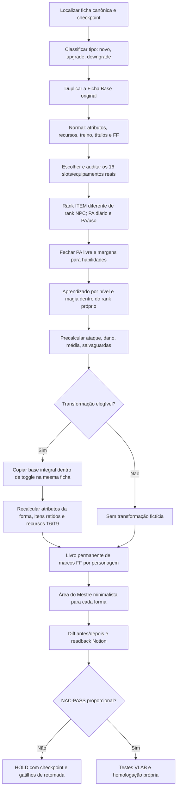

# LEVEL-UP R216-P17 — auditoria e pacote de continuidade MESTRE-SIDE / TEST

**Escopo:** Orc N01–N25, Ficha Base e método de criação / upgrade / downgrade de NPC. **Validade:** análise TEST e registro recuperável; este arquivo não é uma página canônica no Notion.

## Fontes consultadas
- [Ficha Base](https://app.notion.com/p/a8ac2b324ede83909cfa818a80bc18dd)
- [Criação de Ficha — Regra 6/7/10/11](https://app.notion.com/p/3ebc2b324ede81449222f3c06b840613)
- [PR-ITEM-02 — política vigente de PA](https://app.notion.com/p/3eec2b324ede81ecb058f59f5b67e4f4)
- [Sistema de Magia](https://app.notion.com/p/3ebc2b324ede81f7b343f7270ff91373)
- [Sistema de Transformação Espiritual](https://app.notion.com/p/3f2c2b324ede81c0ae0ee4e66212edc9)
- [Índice das 25 fichas do Orc](https://app.notion.com/p/400c2b324ede8137a06bff45c3b5b1bb)
- [Operação LEVEL-UP existente](https://app.notion.com/p/3f2c2b324ede81f48f80f6d27449d107)

## Gate: estado físico conferido e limitação de escrita

- **VERIFICADO fisicamente no Notion:** páginas N01–N04 e N24–N25 tiveram o inventário revisto em 16 posições, preços individualizados e PA livre recalculado. Em N24/N25, a projeção de PA livre transformado foi colocada em HOLD até comprovar retenção de equipamento/Anéis.
- **PENDENTE e NÃO escrito:** N05–N23; o arquivo apresenta as contas prontas para conferir e aplicar. N05/N23 e alteração do método foram tentadas, mas o controle da ferramenta bloqueou; nenhuma persistência foi presumida.
- **NÃO executado:** VLAB, escritor HOST do LEVEL-UP, CRAFT/F5, estoque oficial, Party/O Primeiro. Testes aritméticos locais não substituem NAC-PASS global.

## PA — método calculado

| Rank do **item** | Base da habilidade | Passiva PA/dia | Ativa PA/dia | Ativação PA/uso | Piso do item PA/dia |
|---|---:|---:|---:|---:|---:|
| Bronze | 6 | 6 | 3 | 3 | 8 |
| Prata | 12 | 12 | 6 | 7 | 11 |
| Ouro | 24 | 24 | 12 | 14 | 21 |
| Ouro Negro | 35 | 35 | 17 | 21 | 35 |
| Lendário | 50 | 50 | 25 | 30 | 90 |

**Regra operacional:** custo diário do item parte de `max(piso do item, componentes realmente aplicáveis)`, respeitando a política do motor R26/R29–R38 e a não duplicação de uma mesma habilidade. O custo de ativação é debitado APENAS por uso. `+1 atributo = 5 PA/dia` quando aplicável. O personagem ser Lendário não torna automaticamente Lendários todos os seus itens.

## Inventário de 16 componentes — classificação TEST individualizada

| Item | Bronze | Prata | Ouro | Ouro Negro | Lendário | Efeito/identidade (TEST) |
|---|---:|---:|---:|---:|---:|---|
| Couraça da Muralha | Bronze | Prata | Ouro | Ouro Negro | Lendário | CA física do estágio; ativação da CA mágica; duas fontes de CA mágica não se acumulam sem validação. |
| Machado da Ruptura | Bronze | Prata | Ouro | Ouro Negro | Lendário | Arma principal com dano físico por estágio e Ruptura condicionada a acerto e PA/uso. |
| Manoplas da Bigorna | Bronze | Bronze | Prata | Ouro | Ouro | FOR temporária, por ativação; nunca somar FOR automaticamente ao dano. |
| Cinto do Bastião | Bronze | Bronze | Prata | Ouro | Ouro | CON temporária; recalcular os derivados ativos; não produzir cura automática. |
| Botas da Escarpa | Bronze | Prata | Prata | Prata | Prata | DES temporária; não eliminar a penalidade física da armadura pesada. |
| Anel da Guarda | Bronze | Prata | Ouro | Ouro Negro | Ouro Negro | CA mágica ativada em ataque declarado; distinto dos dois Anéis da Alma. |
| Elmo do Estandarte | Bronze | Bronze | Prata | Prata | Prata | Vontade contra medo na guarda de escolta reconhecida. |
| Capa do Desfiladeiro | Bronze | Bronze | Prata | Ouro Negro | Ouro Negro | Furtividade em rochas/penumbra, não a redução de 75 dano previamente não demonstrada. |
| Braçadeiras do Golpe Medido | Bronze | Bronze | Ouro | Ouro | Ouro | Bônus no teste de ataque de duas mãos após preparação; não confundir com dano. |
| Amuleto da Forja | Bronze | Bronze | Prata | Ouro | Ouro | INT para Inscrições/Alquimia preparada; não cria vagas de treinamento. |
| Anel de Golpe | Bronze | Prata | Ouro | Ouro | Ouro | Bônus de acerto; alternativa ao Anel da Guarda; slots com Anéis da Alma em HOLD. |
| Insígnia da Escolta | Bronze | Bronze | Prata | Prata | Prata | Apoio à Vontade de aliado contra medo em alcance e ação definidos. |
| Arnês Antitombo | Bronze | Bronze | Prata | Ouro | Ouro | Redução limitada de empurrão em solo; compatibilidade corporal e AoO em HOLD. |
| Espada da Guarda | Bronze | Prata | Ouro | Ouro Negro | Lendário | Alternativa de uma mão com escudo; incompatível com ataque de machado de duas mãos. |
| Escudo de Passagem | Bronze | Bronze | Prata | Ouro | Ouro Negro | Reserva física; CA do escudo em HOLD, sem inventar. |
| Selo de Emergência | Bronze | Bronze | Prata | Ouro | Ouro Negro | Consumível experimental ainda não fabricado; controle de carga CRAFT HOLD. |

Os itens de reserva custam **0 PA/dia apenas porque estão desligados no loadout**; isso NÃO os converte em artefatos gratuitos quando energizados. A combinação de arma de duas mãos e escudo continua incompatível no mesmo ataque. Todos os itens são TEST e dependem de CRAFT para se tornarem produtos reais.

## Tabela de progressão: antigo × cenário auditado

| Nível | Rank | Energizados | PA bruto | PA/dia antigo | PA/dia individualizado TEST | PA livre antigo | PA livre TEST | Notion |
|---:|---|---:|---:|---:|---:|---:|---:|---|
| 01 | Bronze | 8 | 122 | 64 | 64 | 58 | **58** | READBACK |
| 02 | Bronze | 10 | 131 | 80 | 80 | 51 | **51** | READBACK |
| 03 | Bronze | 11 | 142 | 88 | 88 | 54 | **54** | READBACK |
| 04 | Bronze | 12 | 154 | 96 | 96 | 58 | **58** | READBACK |
| 05 | Bronze | 13 | 168 | 104 | 104 | 64 | **64** | PENDENTE |
| 06 | Prata | 13 | 216 | 143 | 119 | 73 | **97** | PENDENTE |
| 07 | Prata | 13 | 234 | 143 | 119 | 91 | **115** | PENDENTE |
| 08 | Prata | 13 | 253 | 143 | 119 | 110 | **134** | PENDENTE |
| 09 | Prata | 13 | 273 | 143 | 119 | 130 | **154** | PENDENTE |
| 10 | Prata | 13 | 295 | 143 | 119 | 152 | **176** | PENDENTE |
| 11 | Ouro | 13 | 367 | 273 | 193 | 94 | **174** | PENDENTE |
| 12 | Ouro | 13 | 390 | 273 | 193 | 117 | **197** | PENDENTE |
| 13 | Ouro | 13 | 414 | 273 | 193 | 141 | **221** | PENDENTE |
| 14 | Ouro | 13 | 439 | 273 | 193 | 166 | **246** | PENDENTE |
| 15 | Ouro | 13 | 465 | 273 | 193 | 192 | **272** | PENDENTE |
| 16 | Ouro Negro | 13 | 578 | 455 | 299 | 123 | **279** | PENDENTE |
| 17 | Ouro Negro | 13 | 607 | 455 | 299 | 152 | **308** | PENDENTE |
| 18 | Ouro Negro | 13 | 636 | 455 | 299 | 181 | **337** | PENDENTE |
| 19 | Ouro Negro | 13 | 666 | 455 | 299 | 211 | **367** | PENDENTE |
| 20 | Ouro Negro | 13 | 697 | 455 | 299 | 242 | **398** | PENDENTE |
| 21 | Lendário | 9 | 891 | 810 | 335 | 81 | **556** | PENDENTE |
| 22 | Lendário | 9 | 930 | 810 | 335 | 120 | **595** | PENDENTE |
| 23 | Lendário | 9 | 969 | 810 | 335 | 159 | **634** | PENDENTE |
| 24 | Lendário | 10 | 1008 | 900 | 356 | 108 | **652** | READBACK |
| 25 | Lendário | 10 | 1048 | 900 | 356 | 148 | **692** | READBACK |

## Dano — médias matemáticas sem FF nem buffs condicionais

| Rank | Machado normal | Média | Ruptura no acerto | Média com Ruptura | Espada reserva | Média |
|---|---|---:|---|---:|---|---:|
| Bronze | 4d6 | 14 | +1d6 | **17.5** | 2d8 | 9 |
| Prata | 6d6 | 21 | +2d6 | **28** | 3d8 | 13.5 |
| Ouro | 8d6 | 28 | +4d6 | **42** | 4d8 | 18 |
| Ouro Negro | 10d6 | 35 | +9d6 | **66.5** | 5d8 | 22.5 |
| Lendário | 12d6 | 42 | +16d6 | **98** | 6d8 | 27 |

Outras parcelas: Tranco de Guarda +1d4 (média +2,5); Golpe Fendido +4d6 (média +14); título Discípulo da Bigorna +1d8 (média +4,5, somente no gatilho); Quebra-Escudos +1d6 (média +3,5, no gatilho); Rompe-Muralhas +4d8 (média +18, somente estruturas); Voto da Última Muralha +1d10 (média +5,5, no gatilho).

Espírito TEST: Pisada Quebra-Linha 4d8+6 (média 24); Terremoto Raso 5d8 (média 22,5); Sentença do Titã 15d6+18 (média 70,5); Bastião Vivo 8d10 de Vida temporária (média 44, **não é dano**).

**Cautelas:** médias são expectativas matemáticas de dados, não dano efetivo após RD, resistência elemental, erro, crítico ou efeitos não testados. Não presumir que Ruptura e Golpe Fendido podem ser ativados sobre o mesmo ataque sem confirmar ação e custo. Crítico positivo garante acerto mas RD pode zerar o dano.

## Trilha de aprendizado adicional — PROPOSTA, NÃO inserida no Notion

A ficha L25 já continha cinco técnicas marciais, cinco do Espírito e Ruptura do Machado. O problema é apresentação, identidade e disponibilidade situacional, **não ausência literal de todas as habilidades**. Não ultrapassar o teto de técnicas de Espírito só para ampliar a lista.

- **N08 — Passo da Escolta (marcial / Prata, PROPOSTO):** ação de movimento, 12 PA; desloca-se para proteger aliado adjacente usando terreno firme. Não cria reação ou ataque extra; alcance e gatilhos precisam de VLAB.
- **N13 — Selo do Cascalho (magia própria aprendida / Ouro, PROPOSTO):** ação padrão, 24 PA; cria zona de cascalho em raio curto que atrapalha deslocamento por dois turnos. Resistência Reflexo contra CD = proficiência + INT + bônus comprovados. Área, duração, resistência e tipo de dificuldade sujeitos a teste; sem magia acima do rank próprio.
- **N18 — Ancoragem de Bigorna (marcial / Ouro Negro, PROPOSTO):** ação de movimento, 35 PA; tentativa de firmar posição contra deslocamento forçado 1,5m. Não anula ataques de oportunidade e não concede imunidade universal.
- **N22 — Muralha de Cinzas (magia própria aprendida / Lendário, PROPOSTO):** ação padrão, 50 PA; terreno protetor de duração curta. Vida, CA, RD e efeito de área da barreira dependem de norma, DMG e testes do VLAB. Não inserir valores inventados.

Essas quatro propostas só devem ser distribuídas progressivamente se o conceito e os dados de origem do NPC justificarem aquisição e aprendizado; os 5/5 poderes do Espírito continuam em seu próprio bloco, sem promover a Besta junto com o Orc.

## Fluxo obrigatório a inserir na Regra 11 quando a escrita voltar a ser permitida

### Regras de apresentação e competências do Comestre

1. **Perícias:** na Ficha Base, apenas cabeçalho de proficiência, 26 nomes, ⭐ quando treinada e números para rolar; fórmulas e metodologia fora da ficha, na Regra 7/11.
2. **FF:** no alternante BÔNUS→FF registrar somente marcos atingidos na ordem `100 FF — +3 dano`, `200 FF — +5 Vida`, etc., com o VALOR REAL rolado. Nunca inventar ou substituir rolagem histórica. Se a FF cair o bônus fica inativo mas o lock persiste; transformação e item podem cruzar marcos, sem reroll.
3. **Área do Mestre:** somente Vida atual/máxima, PA livre, ações/reação e defesa, CD/ataques e dados de dano **com média por variante**; sem PA bruto/comprometido no resumo. A ficha completa mantém a contabilidade auditável.
4. **Itens:** classe material e item mágico não são presumidos da classe do NPC. Definir papel, status, efeito, PA diário, PA de ativação, incompatibilidades e a diferença passiva/ativa. Não energizar acessórios sem utilidade definida.
5. **Progressão:** títulos e habilidades não existem retroativamente a menos que a regra o determine; mágica requer aprendizado, custo, ação e CD correta. Em downgrade, restaurar a versão da classificação, desativar benefícios inelegíveis, preservar histórico/FF e não apagar títulos adquiridos sem autoridade.
6. **Transformação:** mesma página, cópia da ficha base dentro de alternante completo; preservar identidade de pessoa e título sem dupla contagem; compatibilidade dos itens e T6/T9 condicionais até demonstração.
7. **Auditoria:** comparar ANTES/MUDANÇA/DEPOIS para todas as formas e para os 25 níveis; aplicar leitura física de retorno; nunca afirmar 25/25 se seis realmente foram gravados. Registro operacional só no Diário/OP, não dentro da ficha.

## Ponto exato de retomada

**Estado persistido confirmado:** N01–N04, N24–N25. **Restam 19 fichas:** N05–N23, com inventário individual a gravar. O manifesto anexo contém todas as contas. Primeiro comparar timestamp/hash da página com o snapshot, verificar se outro Comestre a alterou, então inserir blocos específicos, recalcular PA e atualizar transformação apenas após compatibilidade, sem duplicar páginas. Posteriormente acrescentar médias e habilidades aprovadas, rever metodologia da Regra 11 e executar NAC-PASS.

### Verificação estrutural física — leitura final

25/25 páginas reabertas; 25/25 inventários com 16 blocos; 25 formas normais e 20 transformadas; 30 toggles por Bronze e 44 toggles por Prata–Lendário, sem alteração estrutural indevida detectada. A verificação física **não** estende o PASS de preços para os 19 níveis que permanecem sem edição. Os 25 UUIDs foram preservados no manifesto JSON para retomada sem duplicatas.

## FF — limiares teóricos recuperados, sem inventar rolagens

| Nível | FF normal | FF transformada potencial | Marcos 100FF possíveis |
|---:|---:|---:|---:|
| 01 | 280 | não elegível | 2 |
| 02 | 320 | não elegível | 3 |
| 03 | 350 | não elegível | 3 |
| 04 | 390 | não elegível | 3 |
| 05 | 420 | não elegível | 4 |
| 06 | 450 | 1050 | 10 |
| 07 | 490 | 1190 | 11 |
| 08 | 530 | 1330 | 13 |
| 09 | 570 | 1470 | 14 |
| 10 | 600 | 1600 | 16 |
| 11 | 650 | 1750 | 17 |
| 12 | 700 | 1900 | 19 |
| 13 | 740 | 2040 | 20 |
| 14 | 780 | 2180 | 21 |
| 15 | 820 | 2320 | 23 |
| 16 | 850 | 2450 | 24 |
| 17 | 900 | 2600 | 26 |
| 18 | 950 | 2750 | 27 |
| 19 | 990 | 2890 | 28 |
| 20 | 1030 | 3030 | 30 |
| 21 | 1380 | 3480 | 34 |
| 22 | 1430 | 3630 | 36 |
| 23 | 1490 | 3790 | 37 |
| 24 | 1560 | 3960 | 39 |
| 25 | 1610 | 4110 | 41 |

O máximo teórico N25 é 41 marcos (4.110 FF) caso a transformação seja efetivamente ativada; no estado normal há 16 (1.610 FF). **Nenhuma escolha/dado/lock foi inventado**, pois cruzar marcos potenciais não comprova que foram realmente atingidos na cronologia. A transformação começa a ser elegível em N06, mas a ativação verdadeira não foi demonstrada neste pacote.

## Teste de capacidade para pagar transformação (somente limiar aritmético)

| Nível | T9 PA/uso | Livre antigo normal | Livre candidato normal | Consequência |
|---:|---:|---:|---:|---|
| 6 | 40 | 73 | 97 | Ambos cobrem apenas o custo inicial; transição/itens HOLD |
| 11 | 80 | 94 | 174 | Ambos cobrem apenas o custo inicial; transição/itens HOLD |
| 16 | 160 | 123 | 279 | NÃO pagava de FULL antigo; pagaria do novo FULL, mas compatibilidade e transição HOLD |
| 21 | 320 | 81 | 556 | NÃO pagava de FULL antigo; pagaria do novo FULL, mas compatibilidade e transição HOLD |

A disponibilidade aritmética de PA **não autoriza** declarar ativação real da transformação, nem converter Alma espiritual de T6-B em PA livre e nem carregar equipamentos de anatomia incompatível.

## Cartão operacional calculado — Orc Lendário 5★ (somente referência TEST)

| Uso | Cálculo independente | Resultado ou média |
|---|---|---:|
| Acerto com machado / Luta FOR | 6d6 + FOR efetiva 58 + treino 20 | **6d6+78** |
| Acerto alternativo Luta DES, se o estilo permitir | 6d6 + DES 38 + treino 20 | **6d6+58** |
| Reflexo treinado | 6d6 + DES 38 + treino 20 | **6d6+58** |
| Fortitude treinada | 6d6 + CON efetiva 65 + treino 20 | **6d6+85** |
| Machado simples | 12d6 físico | **42** |
| Machado + Tranco de Guarda | 12d6 + 1d4 físico, ao acertar, 6 PA/uso | **44,5** |
| Tranco em armadura com título Discípulo da Bigorna | 12d6 + 1d4 + 1d8 físico, se ambos gatilhos válidos | **49** |
| Golpe Fendido | 12d6 + 4d6 físico, ao acertar, 24 PA/uso | **56** |
| Machado + Ruptura Lendária | 12d6 + 16d6 físico, no acerto, 30 PA/uso | **98** |
| Machado vs estrutura com Rompe-Muralhas | 12d6 + 4d8, gatilho de estrutura | **60** |
| Machado com Voto da Última Muralha | 12d6 + 1d10, 1/cena, protege aliado adjacente | **47,5** |
| Pisada Quebra-Linha do Espírito | 4d8+6 Terra, antes de salvaguarda | **24** |
| Terremoto Raso do Espírito | 5d8 Terra, antes da salvaguarda | **22,5** |
| Sentença do Titã | 15d6+18 impacto, se acerta | **70,5** |
| Bastião Vivo | 8d10 Vida temporária, NÃO é dano | **44 de Vida temporária** |

**Condições:** todos os números de ataque/FF seguem os atributos TEST publicados, sem assumir que um buff de item foi ativado; não há soma de marcos FF não rolados; ataque para acertar e dano são cálculos distintos; não assumir combinação de Golpe Fendido com Ruptura sem confirmar ação; dano efetivo ainda depende de acerto, RD e resistência. Os cálculos de dano natural da transformação continuam em HOLD, não foram inventados para “completar” uma ficha.
