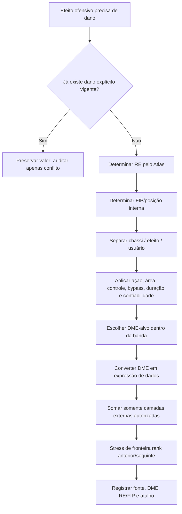

# Snapshot técnico Notion — DMG_RANK_01

> **MESTRE-SIDE · SNAPSHOT DOCUMENTAL · NAO E NOVO CANON.** Fonte viva e historico: https://app.notion.com/p/3f2c2b324ede815498cddb7844245f7e. Captura realizada em 2026-10-28. Nao confundir snapshot com implementacao testada, release, aprovacao NAC-PASS ou autorizacao para escrita Party.
> Origem Notion UUID: `3f2c2b32-4ede-8154-98cd-db7844245f7e`. Marcacoes de Notion (<mention>, <callout>, <page>) podem estar em formato Notion Markdown; consultar fonte viva para as versoes vigentes. Estado da busca: pagina completa recebida pelo conector em 2026-10-28, sem prova de execucao mecanica.

---

<callout icon="⚔️" color="yellow_bg">
<b>DMG-RANK-01 v1.1 — SISTEMA UNIVERSAL DE DANO POR CLASSIFICAÇÃO — OFICIAL / VIGENTE / MESTRE-SIDE.</b> Autoridade para criar, revisar e pré-calcular dano de armas, habilidades, magias e efeitos ofensivos quando a fonte específica não possui valor numérico. Não substitui dano canônico já explícito. Promoção após NAC-NORM, regressão 10/10, stress universal 60/60, stress VZ 16/16, TEE 8/8, MIE 9/9, GNN/GP-NAC e NAC-PASS-02.
</callout>

# 1. Problema que esta regra resolve

O Sistema de Combate exige que a ficha traga o dano normal já calculado; o Sistema de Magia exige que cada magia registre dano quando aplicável; PR-ITEM/REC-MOD-ARM exige mecânica completa; o Atlas de Poder classifica o efeito. Faltava a ponte numérica universal entre <b>Rank de Efeito (RE)</b> e <b>dano-base</b>.

Esta norma fecha apenas essa lacuna. Ela não recalibra retroativamente todo o acervo e não apaga valores históricos.

# 2. Autoridades e precedência

1. valor de dano explícito e vigente do próprio objeto/habilidade/magia;
2. correção expressa do Mestre;
3. sistema especializado competente, como Criação de Besta para dano-base de Bestas;
4. DMG-RANK-01;
5. benchmark/inferência.

Fontes-mãe: Sistema de Combate, Sistema de Magia, Criação de Ficha, Criação de Besta, PR-ECO-01/Anexo A, PR-ITEM-02/REC-MOD-ARM-01 e Sistema de Transformação Espiritual.

# 3. Princípio central — classificar primeiro, numerar depois

Fluxo:

<code>EFEITO → RE/RANK → FIP/posição interna → perfil ofensivo → modificadores de entrega → orçamento de dano → expressão em dados → bônus externos → stress → ficha</code>.

Nunca escolher dados primeiro e depois declarar o rank para justificar.

# 4. Grandeza comum — DME

<b>DME = Dano Médio Esperado dos dados + bônus fixo intrínseco do efeito.</b>

Para um dado dN: média = (N+1)/2.

Ex.: 4d8+8 → DME = 4×4,5+8 = 26.

DME existe para comparar expressões diferentes; durante o jogo continuam sendo rolados os dados registrados.

<b>Não entram no DME intrínseco:</b> FOR/INT do usuário, bônus de FF, título, transformação, item externo, fraqueza elemental, crítico ou combo que não pertença ao efeito analisado.

# 5. Bandas ofensivas intrínsecas por Rank de Efeito

Estas bandas são para <b>um efeito ofensivo padrão, alvo único, Ação Padrão, sem hard-control e sem bypass maior</b>.

<table fit-page-width="true" header-row="true">
<tr>
<td>
RE
</td>
<td>
Entrada
</td>
<td>
Baixa
</td>
<td>
Média
</td>
<td>
Alta
</td>
<td>
Ápice
</td>
<td>
Faixa operacional DME
</td>
</tr>
<tr>
<td>
Bronze
</td>
<td>
4–6
</td>
<td>
7–9
</td>
<td>
10–12
</td>
<td>
13–15
</td>
<td>
16–18
</td>
<td>
4–18
</td>
</tr>
<tr>
<td>
Prata
</td>
<td>
14–18
</td>
<td>
19–22
</td>
<td>
23–26
</td>
<td>
27–31
</td>
<td>
32–36
</td>
<td>
14–36
</td>
</tr>
<tr>
<td>
Ouro
</td>
<td>
22–28
</td>
<td>
29–35
</td>
<td>
36–44
</td>
<td>
45–52
</td>
<td>
53–62
</td>
<td>
22–62
</td>
</tr>
<tr>
<td>
Ouro Negro
</td>
<td>
38–48
</td>
<td>
49–58
</td>
<td>
59–69
</td>
<td>
70–82
</td>
<td>
83–96
</td>
<td>
38–96
</td>
</tr>
<tr>
<td>
Lendário
</td>
<td>
58–72
</td>
<td>
73–90
</td>
<td>
91–112
</td>
<td>
113–136
</td>
<td>
137–160
</td>
<td>
58–160
</td>
</tr>
</table>

Estas faixas descrevem o <b>efeito isolado</b>. Fichas Lendárias podem ultrapassar muito 160 após somar corpo, FF, transformação, títulos, itens, efeitos condicionais e combos; isso não altera o DME intrínseco do componente.

# 6. Evidência usada para calibrar as bandas

- Criação de Besta: dano-base normal 3d6→6d6→9d6→12d6 e progressão Titã 5d10→8d10→11d10→13d10→20d10; é âncora de criatura, não tabela de personagem.
- Bronze: Jato de Bolhas 1d6+INT; Fa Bushi usa componentes 1d8/1d4 e pequenos bônus.
- Prata: Dong Goui possui 3d8+6 em arma/técnica; fichas P2/P3 mostram dano especializado na casa de dezenas.
- Ouro: Gorrok O1 registra Espada Curva 5d8 e Explosão de Terra 4d6; Sunarco O3 registra +4d8+8; O5 mostra pacotes já superiores.
- Ouro Negro: Adaga da Serpente Enfeitiçada possui 5d4+5d8+10 + veneno 3d12/turno sob falha; Shen Yaki ON4 possui ataques com bônus fixos altos.
- Lendário: Arco Exterminador Elemental registra 8d8+25 e bônus especializado; personagens L1 completos mostram dano final muito superior por stacking; Espada do Lendário é outlier Ápice/artefato extremo e não define o centro.

Os exemplos são comparadores; valores históricos permanecem válidos onde já são canônicos.

# 7. Relação entre estrelas/FIP e dano

Para <b>personagem/Besta com estrelas</b>, a estrela pode servir como primeira régua interna do efeito nativo:

1★≈Entrada · 2★≈Baixa · 3★≈Média · 4★≈Alta · 5★≈Ápice.

Isso não é automático: efeito utilitário, técnica deliberadamente fraca/forte, custo alto ou herança especial pode ocupar outra posição, desde que justificado pelo Atlas.

Para <b>itens</b>, nunca usar estrelas públicas. Usar FIP interna Entrada/Baixa/Média/Alta/Ápice conforme PR-ECO-01.

Para <b>magia/habilidade sem estrela/FIP</b>, determinar posição pelos três comparadores do Atlas; não preencher “Média” por padrão.

# 8. Chassi de arma comum — dano físico não classificado

Arma comum sem poder sobrenatural não recebe RE só porque o usuário é forte.

| Chassi | Dano-base | Uso típico |
| --- | --- | --- |
| Improvisada/ínfima | 1d3 | objeto não feito para combate |
| Leve | 1d4 | adaga, lâmina pequena, ferramenta leve |
| Leve-marcial | 1d6 | bastão leve, vara curta, lâmina-leque, arma curta |
| Marcial padrão | 1d8 | espada, lança, arco, arma de uma mão equivalente |
| Pesada/versátil | 1d10 | malho, machado pesado, arma longa de impacto |
| Duas mãos/brutal | 2d6 | arma dedicada a impacto máximo |

O atributo do usuário só entra quando outra regra disser que entra. FF, Extensão Corporal, títulos e efeitos mágicos são camadas separadas.

Uma arma mágica/classificada pode substituir ou ampliar este chassi; o <b>dano intrínseco total do item</b> deve cair na banda do RI/RE após considerar seus riders.

# 9. Perfis de entrega e ajuste do orçamento

Partir da banda/FIP e ajustar <b>antes</b> de escolher os dados.

| Fator | Ajuste de dano recomendado |
| --- | --- |
| Ação Padrão, alvo único | 100% |
| Ação Completa | 110–130% |
| Movimento ou Reação ofensiva | 65–80% |
| Ação Livre ofensiva repetível | 30–50% |
| Pequena área / 2–3 alvos plausíveis | 70–85% por alvo |
| Área média | 55–70% por alvo |
| Área grande/muitos alvos | 35–55% por alvo |
| Dano contínuo | 25–50% da banda por tick; total esperado pode alcançar 110–140% se houver duração/condição real |
| Meio dano em Salvaguarda bem-sucedida | pode operar próximo de 100% da banda |
| Dano garantido sem ataque/salvaguarda | 75–85% |
| Ignora RD/armadura relevante | 70–85% |
| Dano direto à Alma/essência | 60–80% salvo autoridade específica |

Os percentuais são orçamento de construção, não multiplicadores usados em mesa.

# 10. Riders — dano versus controle

- efeito puramente danoso: pode usar toda a banda;
- rider leve (empurrão curto, marca, -movimento pequeno): 85–95%;
- rider relevante (derrubar, desarmar, penalidade forte curta): 70–85%;
- hard-control (atordoar, imobilizar, silenciar totalmente): 45–70%, conforme salvaguarda/duração;
- execução, amputação, insta-kill, negar morte, quebrar regra fundamental: nunca compensar só reduzindo dano; classificar como bypass e aplicar Atlas/Mestre.

Quando a habilidade permite <b>escolher entre dano e controle</b>, cada modo pode ter seu próprio orçamento e o modo de controle não precisa reduzir o dano do modo puramente ofensivo.

# 11. Magias

- usar o RE da versão da magia;
- a magia não recebe crítico salvo exceção explícita vigente;
- Ação Padrão/alvo único usa a banda integral;
- área, controle, duração, bypass e garantia ajustam o orçamento;
- custo em PA é limitador real e pode sustentar FIP maior dentro do mesmo rank, mas PA alto não compra automaticamente o rank seguinte;
- PAD continua sendo bônus externo +3d13 por Classificação conforme Sistema de Magia e não é embutido no dano-base;
- Fraqueza Elemental continua sendo camada externa do Sistema de Combate.

# 12. Habilidades marciais/técnicas

Classificar o <b>efeito</b>, não o usuário. Um Lendário pode usar uma técnica Bronze.

Ataque que diz “usa ataque normal” conserva dano da arma e acrescenta somente o delta explicitamente criado pela técnica.

Técnica de burst que consome Ação Completa/custo alto pode usar 110–130% da banda, mas telegraph/cooldown precisam ser reais.

# 13. Armas classificadas

<code>Dano final do golpe = dano intrínseco da arma + bônus do usuário autorizados + FF ativo + efeitos temporários</code>.

O RI da arma mede o que a arma acrescenta isoladamente.

Se a arma possui grande controle, veneno, bypass, mobilidade ou defesa, parte do orçamento de poder está nesses eixos; não exigir que seu dano sozinho atinja o teto do rank.

# 14. Conversão DME → dados

Escolher expressão que preserve identidade e fique na faixa de DME.

Preferências:

- muitos dados menores = consistência;
- poucos dados grandes = volatilidade/burst;
- bônus fixo = confiabilidade;
- elementos diferentes podem usar pools separados apenas quando mecanicamente necessário.

Exemplos de referência aproximada:

Bronze Média: 3d6≈10,5.

Prata Média: 5d8≈22,5 ou 4d10≈22.

Ouro Média: 8d10≈44.

Ouro Negro Média: 11d10≈60,5.

Lendário Média: 16d12≈104.

Não há obrigação de usar esses formatos; DME e identidade governam.

# 15. Dano final e stacking

Ordem:

1. dano intrínseco;
2. atributo se a arma/magia explicitamente o usa;
3. bônus fixos do item/habilidade/título;
4. FF ativo e Registro Permanente;
5. Transformação/estado;
6. buffs/debuffs;
7. Fraqueza Elemental;
8. crítico, somente quando aplicável.

Não duplicar a mesma fonte em duas camadas.

# 16. Crítico, resistência e reflexão

Crítico continua exatamente no Sistema de Combate e não redefine a banda-base.

RD/resistência não é usada para inflar previamente o dano-base.

Reflexão de magia usa metade do dano efetivamente definido pela magia conforme sistema vigente.

# 17. Fluxograma universal

# 18. Gate de criação

Uma nova arma/habilidade/magia ofensiva só fecha quando houver:

- RE e evidência;
- FIP/posição interna quando necessária;
- tipo de dano;
- ação;
- alvo/alcance/área;
- custo;
- dano-base;
- atributo externo, se houver;
- riders;
- salvaguarda/teste;
- duração/ticks;
- bypass;
- interação com crítico;
- interação elemental;
- DME calculado;
- benchmark inferior e superior;
- stress de abuso/stacking;
- atalho pronto para ficha.

# 19. Não-retroatividade automática

DMG-RANK-01 não manda reescrever todos os danos antigos. Valores existentes permanecem até revisão dirigida, conflito ou uso material que exija JIT.

# 20. Estado

<code>STATUS=OFICIAL/VIGENTE — v1.1</code>.

Hardening v1.1 aprovado por regressão do corpus + stress delta 30/30 + TEE v1.1 10/10 + MIE 9/9 + GNN/GP-NAC; promoção sujeita ao reopen físico imediato e NAC-PASS-02 terminal. Não-retroatividade automática permanece obrigatória.

<page url="https://app.notion.com/p/3f2c2b324ede81dd93cdffead1cf0d6b">
AUD-DMG-RANK-01 — NAC-NORM + Stress de Dano
</page>

# 21. Taxonomia universal de dano — v1.1

A <b>magnitude</b> do dano e o <b>tipo/tag</b> do dano são eixos independentes. O Rank de Efeito/FIP define o orçamento; o tag define quais resistências, fraquezas e interações podem ser consultadas.

## 21.1 Tags de natureza

### Físico

- <b>Cortante</b> — lâmina, garra, vento cortante quando a fonte realmente o classificar assim.
- <b>Perfurante</b> — ponta, projétil, ferrão, penetração.
- <b>Impacto/Contundente/Concussão</b> — massa, choque, esmagamento ou pressão mecânica.

Uma arma pode ter mais de um modo, mas cada ataque declara qual está usando.

### Elemental

Quando a fonte atribui um Elemento canônico ao dano, preservar exatamente esse Elemento. Exemplos físicos do acervo incluem Água, Gelo, Vento, Fogo, Terra, Lightning/Raio, Chaos/Caos, Dark/Sombrio, Luz, Planta e Spectral/Espectral <b>quando a própria autoridade da entidade/efeito usa esse tag</b>.

<b>Não converter sinônimos históricos automaticamente.</b> “frio”, “ácido”, “radiante”, “necrótico” ou “psíquico” não viram Gelo, Planta, Luz, Dark ou Spectral apenas por semelhança nominal.

### Tóxico/biológico

Veneno, toxina e efeitos equivalentes são tags próprios quando assim escritos. Em geral usam aplicação condicionada + Salvaguarda + DoT/penalidade; não recebem Fraqueza Elemental salvo regra explícita.

### Alma/Essência

Dano que atinge diretamente Alma, essência, espírito ou reserva existencial é <b>bypass especializado</b>. Aplicar o ajuste 60–80% do orçamento de dano salvo regra superior. Dreno de PA não é automaticamente dano de Vida.

### Tags legados/específicos

Psíquico, necrótico, radiante, ácido e outros termos existentes no acervo são preservados literalmente quando uma fonte vigente os utiliza. DMG-RANK não os promove silenciosamente a novo Elemento universal.

## 21.2 Tags de entrega

Registrar separadamente:

- impacto direto;
- projétil;
- área;
- multi-hit;
- dano contínuo/DoT;
- aura/contato;
- contra-ataque/reação;
- reflexão;
- gatilho/armadilha;
- ambiental/colisão/queda;
- invocação/entidade secundária;
- auto-dano/recuo;
- execução/bypass;
- dano a recurso/Alma.

O mesmo dano pode ter natureza + entrega, por exemplo: <b>Fogo · área · DoT</b>.

# 22. Dano composto e múltiplos componentes

O orçamento pertence ao <b>efeito/ação inteira</b>, não a cada linha de dano isoladamente.

Exemplo: uma técnica Ouro Média não recebe “8d10 físico + 8d10 Fogo” só porque possui dois tipos. A soma do DME intrínseco dos componentes deve respeitar o orçamento depois dos ajustes.

### Divisão de pool

Pode dividir o orçamento em:

- físico + elemental;
- impacto + veneno;
- dano imediato + DoT;
- múltiplos projéteis;
- arma + rider mágico.

Cada componente mantém seu tag para resistência/fraqueza.

### Multi-hit

Se uma ação lança N golpes/projéteis, o orçamento total da ação é dividido entre eles. Ter vários testes de ataque não multiplica gratuitamente o orçamento do rank.

# 23. Dano contínuo, sangramento e veneno

- O tick típico usa <b>25–50%</b> da banda ajustada.
- A soma esperada condicionada pode alcançar \~110–140% do orçamento de impacto quando a duração, Salvaguarda, cura/interrupção ou exposição realmente limitam o efeito.
- Reaplicar um DoT precisa declarar: acumula, renova duração ou não acumula.
- Sem regra explícita, <b>não acumula infinitamente</b>; a nova aplicação renova a duração.
- Sangramento/veneno que também impõem penalidade dividem orçamento entre dano e rider.

# 24. Área, cone, linha e explosão

A redução de área é aplicada ao <b>dano por alvo</b>. O efeito continua classificado pelo impacto total, alcance e confiabilidade.

- linha estreita: normalmente entre pequena área e alvo único conforme quantidade plausível de alvos;
- cone curto: pequena/média área;
- explosão ampla: média/grande área;
- aura repetida: área + DoT.

Não usar o número máximo teoricamente possível de alvos como se todos fossem garantidos; usar cenário tático plausível no stress.

# 25. Ambiental, queda e colisão

Não foi encontrada fórmula universal vigente de “X metros = YdZ”.

Portanto:

1. se a fonte já possui dano explícito, preservar;
2. se é fenômeno sobrenatural/classificável, classificar seu RE e usar DMG-RANK;
3. se é perigo mundano, classificar a <b>severidade prática do evento</b>, sem transformar o rank da vítima em dano do ambiente;
4. deslocamento causado por habilidade <b>não concede dano de colisão automaticamente</b>. Colisão só causa dano quando a habilidade, terreno ou adjudicação do evento realmente o sustenta.

Perigos incidentais tendem a orçamento reduzido; perigos cuja função central é ferir usam orçamento integral compatível com sua severidade.

# 26. Reflexão, retaliação e dano devolvido

Quando a regra diz “reflete X%/metade do dano”, o valor deriva do dano recebido e <b>não cria novo dano-base</b>.

Ao criar nova reflexão:

- classificar principalmente por Defesa/Bypass/Confiabilidade;
- definir percentual/cap;
- impedir loop infinito de reflexão por padrão: dano refletido não é refletido novamente salvo regra explícita.

A regra vigente de Refletir Magia continua com metade do dano conforme Sistema de Magia.

# 27. Dano garantido, fixo e percentual

### Fixo

Bônus fixo intrínseco entra no DME. Quanto maior a garantia, maior a confiabilidade e menor deve ser a necessidade de volatilidade adicional.

### Garantido sem ataque/save

Aplicar 75–85% do orçamento padrão, salvo limitação real.

### Percentual da Vida/Alma

É bypass de escala e <b>não</b> deve ser criado convertendo a banda DME em porcentagem.

Exige:

- limite mínimo/máximo;
- alvo elegível;
- interação com chefes/outliers;
- frequência;
- Salvaguarda/condição;
- stress específico.

Sem esses campos, fica BLOCKED.

# 28. Dano à Alma, PA e outros recursos

Separar:

- <b>dano de Vida</b>;
- <b>dano de Alma/essência</b>;
- <b>dreno de PA</b>;
- <b>PA comprometido</b>;
- custo voluntário do próprio usuário.

Reduzir PA não significa automaticamente reduzir Vida nem Alma máxima. Efeito que destrói Alma/essência é bypass e recebe análise mais severa.

# 29. Invocações, familiares e entidades secundárias

Se a habilidade cria/invoca uma entidade com ficha:

- o dano da entidade vem da própria autoridade de criatura/ficha;
- o custo/quantidade/autonomia/duração da invocação definem o RE da habilidade;
- não somar o orçamento inteiro da invocação novamente como “dano do conjurador”.

Ataque instantâneo sem entidade persistente continua sendo dano da habilidade.

# 30. Auto-dano, recuo e custo de risco

Auto-dano, consumo de Vida/Alma e recuo podem justificar maior potência <b>somente se forem limitações reais</b>.

Não existe troca universal 1:1 “perdi 20 Vida, ganho +20 dano”.

A limitação ajusta FIP/rank pelo Atlas e depois o dano é derivado normalmente.

# 31. Execução, amputação e efeitos letais

Decapitação, morte instantânea, amputação, destruição de núcleo/Alma e efeitos equivalentes são <b>bypass</b>, não “um número grande de dano”.

Precisam de condição explícita, alvos imunes/inadequados, defesa/salvaguarda quando aplicável e autoridade específica. Quando a condição falhar, um dano alternativo pode existir e é classificado separadamente.

# 32. Resistência, imunidade e Fraqueza

- aplicar resistência/imunidade pelo tag realmente declarado;
- RD genérica segue a autoridade que a concede;
- Fraqueza Elemental só dispara quando o componente ofensivo realmente possui o Elemento relevante;
- um ataque físico + elemental aplica a Fraqueza somente ao pool elemental, conforme Sistema de Combate;
- bypass que ignora resistência deve estar explicitamente classificado como tal e usar orçamento reduzido/Atlas.

# 33. Escalonamento por classificação

Uma magia/habilidade evolutiva pode ter uma versão por rank. Para cada versão:

1. classificar o RE daquela versão;
2. escolher FIP/posição;
3. recalcular alcance/área/controle/custo;
4. derivar novo dano;
5. stressar contra a versão anterior e o próximo rank.

<b>Proibido:</b> multiplicador universal “x2 por rank” ou soma automática de dados sem reclassificar o conjunto.

# 34. Matriz mínima de registro de dano

Todo dano novo/reconstruído deve conseguir responder:

<code>FONTE | RE/FIP | NATUREZA | ENTREGA | AÇÃO | CUSTO | TESTE/SAVE | ALCANCE/ÁREA | DADOS+FIXO | DME | RIDER | DURAÇÃO/TICKS | STACK | BYPASS | CRÍTICO | ELEMENTO/FRAQUEZA | LIMITES | COMPARADORES</code>.

Sem esses campos materialmente aplicáveis, o atalho ainda não está pronto.

<page url="https://app.notion.com/p/3f3c2b324ede8162be5bed7ac9f06b59">
AUD-DMG-RANK-QUALITY-01 — Pesquisa, Classificação e Confiabilidade
</page>

<page url="https://app.notion.com/p/3f3c2b324ede813e9fa0c87ebdea0b29">
OP-DMG-CORPUS-EMP-01 — Dossiê Empírico Supremo de Dano
</page>
