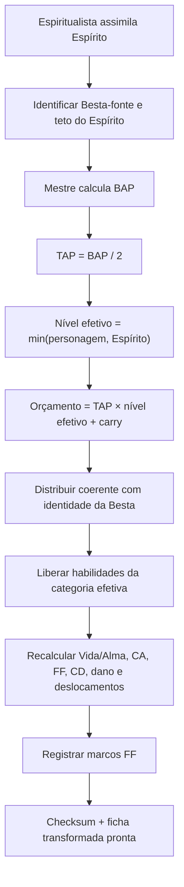
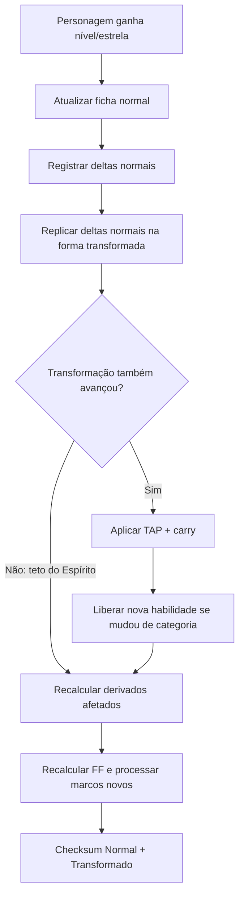

# Snapshot técnico Notion — TRANSFORMACAO_ESPIRITUAL

> **MESTRE-SIDE · SNAPSHOT DOCUMENTAL · NAO E NOVO CANON.** Fonte viva e historico: https://app.notion.com/p/3f2c2b324ede81c0ae0ee4e66212edc9. Captura realizada em 2026-10-28. Nao confundir snapshot com implementacao testada, release, aprovacao NAC-PASS ou autorizacao para escrita Party.
> Origem Notion UUID: `3f2c2b32-4ede-81c0-ae0e-e4e66212edc9`. Marcacoes de Notion (<mention>, <callout>, <page>) podem estar em formato Notion Markdown; consultar fonte viva para as versoes vigentes. Estado da busca: pagina completa recebida pelo conector em 2026-10-28, sem prova de execucao mecanica.

---

<callout icon="✅" color="green_bg">
<b>SISTEMA DE TRANSFORMAÇÃO ESPIRITUAL v1.0 — OFICIAL / VIGENTE / MESTRE-SIDE.</b> Promoção em 07/10/2026 após NAC-NORM S3, stress model-based 40/40, regressão histórica dirigida, TEE nas autoridades-mãe e reabertura física. A projeção Party continua separada e ainda não foi publicada.
</callout>

## Finalidade

Esta é a autoridade mecânica especializada para <b>Espírito Demoníaco e Transformação Espiritual</b>. Ela estende, sem substituir indevidamente, <mention url="https://app.notion.com/p/3ebc2b324ede81449222f3c06b840613" />, <mention url="https://app.notion.com/p/3ebc2b324ede81f1be4be8804ac113c0" /> e <mention url="https://app.notion.com/p/3ebc2b324ede81f4992ac88a3588cacd" />.

<callout icon="🔒" color="red_bg">
<b>MESTRE-ONLY:</b> BAP, fórmula BAP→TAP, modificadores internos que tornam a Besta mais forte e justificativas de engenharia da Besta não são informação Party por padrão.
</callout>

## Vocabulário mecânico

<table fit-page-width="true" header-row="true">
<tr>
<td>
Termo
</td>
<td>
Definição
</td>
</tr>
<tr>
<td>
BAP
</td>
<td>
Progressão de Atributos da Besta viva por nível. MESTRE-ONLY.
</td>
</tr>
<tr>
<td>
TAP
</td>
<td>
Progressão adicional de atributos da Transformação por nível.
</td>
</tr>
<tr>
<td>
Nível ordinal
</td>
<td>
Bronze 1–5 = 1–5; Prata = 6–10; Ouro = 11–15; Ouro Negro = 16–20; Lendário = 21–25.
</td>
</tr>
<tr>
<td>
Nível efetivo
</td>
<td>
Maior nível da Transformação que o personagem consegue acessar naquele momento.
</td>
</tr>
<tr>
<td>
Overlay
</td>
<td>
Camada transformada aplicada sobre a ficha normal atual; não é um segundo personagem independente.
</td>
</tr>
</table>

## Regra T1 — Contrato Besta → Transformação

<b>TAP = BAP ÷ 2.</b>

A progressão normal do personagem <b>não participa desta divisão</b>.

Exemplo Mestre-side: Besta com BAP 30/lvl gera TAP 15/lvl.

### Frações

Quando o resultado terminar em 0,5, a fração nunca é descartada.

- TAP 5,5: no primeiro nível disponível entram 5 pontos e fica carry 0,5;
- no próximo nível, 5,5 + 0,5 = 6;
- o carry volta a 0.

O saldo fracionário deve ficar registrado para auditoria.

## Regra T2 — Teto e nível efetivo

<b>Nível efetivo = min(nível ordinal atual do Espiritualista, nível máximo suportado pelo Espírito).</b>

- Espírito mais forte que o personagem: a Transformação acompanha o personagem.
- Espírito mais fraco: a Transformação para no teto do Espírito.
- Assimilar um Espírito forte quando o personagem já está avançado concede imediatamente o acesso retroativo ao nível efetivo disponível.

### Orçamento acumulado

<b>Orçamento bruto = TAP × nível efetivo.</b>

<b>Orçamento distribuível = parte inteira do orçamento bruto.</b>

<b>Carry = parte fracionária remanescente.</b>

Exemplo: TAP 5,5 em nível efetivo 13 → 71,5 bruto → <b>71 pontos distribuíveis + carry 0,5</b>.

Esse orçamento representa apenas os pontos adicionais próprios da Transformação.

## Regra T3 — Construção do estado transformado

A ficha transformada é calculada como:

<b>Ficha normal atual + evolução normal já conquistada + overlay próprio do Espírito.</b>

Ao subir de nível:

1. atualizar a ficha normal;
2. registrar exatamente os atributos normais distribuídos;
3. replicar os mesmos deltas de atributos na ficha transformada;
4. se a Transformação também avançou, aplicar o TAP correspondente;
5. recalcular todos os derivados afetados.

O estado transformado nunca pode esquecer a evolução normal do personagem.

## Regra T4 — Distribuição do orçamento transformado

Os pontos do TAP não são distribuição livre irrestrita.

Eles devem seguir a <b>identidade mecânica da Besta-fonte</b>: anatomia, funções dominantes, modo de combate, Elemento, comportamento, capacidades e linha evolutiva.

Não é obrigatório copiar a proporção exata dos atributos da Besta.

<callout icon="✅" color="green_bg">
<b>Checksum obrigatório:</b> a soma dos deltas transformados de FOR + DES + CON + INT + SAB + CAR deve ser igual ao orçamento acumulado aplicável, salvo bônus externos explicitamente separados.
</callout>

## Regra T5 — Habilidades herdadas

### Acesso do Espiritualista

Dentro da progressão principal do personagem, o número padrão de habilidades do Espírito acessíveis acompanha a <b>categoria efetiva da Transformação</b>:

<table fit-page-width="true" header-row="true">
<tr>
<td>
Categoria efetiva do personagem/Transformação
</td>
<td>
Habilidades acessíveis padrão
</td>
</tr>
<tr>
<td>
Bronze
</td>
<td>
1
</td>
</tr>
<tr>
<td>
Prata
</td>
<td>
2
</td>
</tr>
<tr>
<td>
Ouro
</td>
<td>
3
</td>
</tr>
<tr>
<td>
Ouro Negro
</td>
<td>
4
</td>
</tr>
<tr>
<td>
Lendário
</td>
<td>
5
</td>
</tr>
</table>

Um personagem Ouro que assimila um Espírito Lendário acessa <b>3</b>, não 5, até evoluir. O acesso retroativo libera imediatamente todas as habilidades correspondentes à categoria efetiva já alcançada.

A Transformação não cria habilidades que a Besta nunca teve. Exceções podem existir, mas precisam estar explicitamente justificadas e autorizadas; nunca devem ser inferidas automaticamente.

### Regra estrutural para Bestas

Na criação/revisão da própria Besta, o número <b>mínimo e alvo ideal</b> de habilidades é:

<table fit-page-width="true" header-row="true">
<tr>
<td>
Categoria da Besta
</td>
<td>
Mínimo / ideal
</td>
</tr>
<tr>
<td>
Bronze
</td>
<td>
1
</td>
</tr>
<tr>
<td>
Prata
</td>
<td>
2
</td>
</tr>
<tr>
<td>
Ouro
</td>
<td>
3
</td>
</tr>
<tr>
<td>
Ouro Negro
</td>
<td>
4
</td>
</tr>
<tr>
<td>
Lendário
</td>
<td>
5
</td>
</tr>
<tr>
<td>
ADM
</td>
<td>
6
</td>
</tr>
<tr>
<td>
Besta Divina
</td>
<td>
6
</td>
</tr>
</table>

Mais habilidades são permitidas quando a criatura realmente exige maior complexidade; excesso sem função deve ser evitado.

ADM e Besta Divina compartilham a mesma categoria quantitativa de habilidades, embora a Besta Divina seja qualitativamente superior.

ADM/Besta Divina <b>não concedem automaticamente um sexto slot ao personagem Lendário</b>. Qualquer acesso de personagem acima de Lendário depende da autoridade específica desse patamar.

## Regra T6 — Vida e Alma da Transformação

A ficha normal continua obedecendo à Regra 5 de Criação de Ficha.

Quando a Transformação está plenamente acompanhando a categoria do personagem, a <b>categoria de dado natural de Vida e Alma da forma transformada é um degrau acima</b>:

<table fit-page-width="true" header-row="true">
<tr>
<td>
Categoria efetiva
</td>
<td>
Dado normal
</td>
<td>
Dado transformado
</td>
</tr>
<tr>
<td>
Bronze
</td>
<td>
d6
</td>
<td>
d8
</td>
</tr>
<tr>
<td>
Prata
</td>
<td>
d8
</td>
<td>
d10
</td>
</tr>
<tr>
<td>
Ouro
</td>
<td>
d10
</td>
<td>
d12
</td>
</tr>
<tr>
<td>
Ouro Negro
</td>
<td>
d12
</td>
<td>
d20
</td>
</tr>
<tr>
<td>
Lendário
</td>
<td>
d20
</td>
<td>
d30
</td>
</tr>
</table>

A forma transformada usa seus valores transformados de <b>CON</b> para Vida e <b>INT</b> para Alma.

A escolha vigente entre <b>rolar</b> ou usar o valor fixo de <b>60% do dado</b> continua válida e deve ficar registrada. <b>ESCLARECIMENTO DO MESTRE — 09/10/2026:</b> o valor fixo OFICIAL do d12 <b>CONTINUA 7</b>, arredondado ao inteiro mais próximo, conforme Criação de Ficha Regra 5. O valor <b>8</b> em certos cálculos históricos resulta de erro antigo assumido pelo Mestre, não de regra atual. O bônus derivado é a DIFERENÇA dos máximos já calculados, conforme T6-B abaixo.

Ao mudar de classificação, o recálculo natural segue o mesmo princípio de Criação de Ficha, usando a categoria aplicável ao estado.

<callout icon="⚠️" color="yellow_bg">
<b>Espírito abaixo da categoria atual do personagem:</b> o teto do Espírito limita TAP e habilidades, mas uma Transformação nunca reduz a Vida/Alma natural já existente da ficha normal. O normal é piso. Somente bônus transformados comprovados são adicionados até futura regra mais específica.
</callout>

### Regra T6-B — Diferença de máximos, reservas e nova ativação (correção expressa Mestre, 09/10/2026)

<b>STATUS:</b> orientação direta do Mestre ATIVA para interpretação de jogo; ciclo NAC-NORM-01/NAC-PASS-02 terminal e teste integrado da automação continuam em verificação, sem publicação automática na Party. Este adendo complementa T6, sem converter a Vida/Alma brutas de uma Besta viva em ficha do personagem.

<b>Cálculo obrigatório, por componente e por nível:</b> primeiro calcular o máximo teórico de <b>Vida transformada</b> pela Regra 5/T6 (inicial aplicável preservado + dado da categoria efetiva superior da Transformação, com opção rolada ou 60% fixo arredondado AO INTEIRO MAIS PRÓXIMO (d12=7), e CON transformada em cada nível conforme o recálculo da classificação + demais modificadores comprovados). Repetir independentemente para o máximo teórico de <b>Alma transformada</b> usando INT transformada. Não somar automaticamente a Vida e a Alma da forma normal à progressão transformada; calcular dois estados completos separados, conciliando fontes para não contar itens/títulos duas vezes.

<b>Diferença concedida:</b> bônus de Vida da Transformação = máximo(0, máximo teórico de Vida transformada − Vida máxima da ficha normal, excluídas as vidas temporárias de equipamento). Bônus de Alma da Transformação = máximo(0, máximo teórico de Alma transformada − Alma/PA máxima normal, sem confundir PA atual, livre ou comprometido com máximo). <b>Exemplo expresso:</b> se Vida teórica transformada é 1.000 e Vida máxima normal é 300, a transformação concede <b>+700 Vida temporária espiritual</b>, não +1.000 e não aumento da Vida normal atual. Exemplo paralelo: Alma teórica transformada 1.000 e Alma máxima normal 500 → <b>+500 Alma/PA adicional da forma</b>.

<b>Três camadas de Vida:</b> a Vida temporária da forma transformada fica em reserva independente da Vida temporária de itens e da Vida normal. Com a forma ativa, dano consome Transformação → Itens → Vida normal. Sem a forma, Itens → Vida normal. O dano excedente e as reduções de máximo devem ser registrados sem desaparecer. Transformar e evoluir não curam Vida normal.

<b>Adicional de Alma/PA:</b> a quantidade +Alma calculada é uma <b>reserva espiritual adicional acessível somente enquanto transformado</b>, distinta da Alma/PA normal já gasta; cada nova ativação válida concede seu adicional completo para aquela transformação. Não recuperar o PA normal gasto. Qual reserva paga primeiro custos de técnicas/magias e como tratar compromissos de PA exige fonte específica/decisão de prioridade antes de automatização material, sem supor conversão em proteção de dano físico.

<b>Nova ativação:</b> cada ativação legitimamente permitida pelo T9-A abre uma nova reserva com <b>100% da Vida temporária transformada</b> e <b>100% do adicional de Alma/PA transformada</b> calculados. Reserva consumida de ativação anterior NÃO reduz o valor da nova ativação; a reserva não é renovada por mera destransformação, troca de Espírito, nível ganho, cena nova sem descanso, ou descanso sem nova ativação autorizada. Ao destransformar, o adicional de forma deixa de estar utilizável, mas o dano já sofrido na Vida normal e o PA normal gasto persistem.

<b>Registro do evento:</b> atestar ACTOR-ID, SCENE-ID novo, descanso concluído após uso anterior (descanso curto aproximadamente 4–6h ou longo), Spirit-ID, tier, opção rolada/fixa, atributos e máximos das duas formas, evento de ativação idempotente e custos/efeitos por fonte. Nenhum re-roll ou novo bônus por repetição do mesmo evento. Faltando qualquer prova para escrita real → HOLD e reconciliação.

<b>Erro histórico reconhecido pelo Mestre:</b> valores antigos de bônus Vida/Alma que não batam com este cálculo devem ser tratados como legado a reconciliar, preservando snapshots existentes. Eles não revogam a regra verdadeira explicitada pelo Mestre. Projeções anteriores R03 feitas com d12=7 permanecem cenários condicionais aritmeticamente compatíveis com a regra fixa atual, mas não certificam fichas históricas; os casos antigos que usaram d12=8 por erro do Mestre devem ser marcados LEGADO, sem converter o erro em norma vigente.

## Regra T7 — Força Física e Registro Permanente de Marcos

<b>FF = (FOR + DES + CON) × 10.</b>

Todo múltiplo de 100 FF é um <b>marco permanente do personagem</b>.

Quando um marco é alcançado pela primeira vez por qualquer fonte válida — corpo normal, Transformação, item, título, habilidade ou outro efeito — registrar:

- valor do marco;
- tipo escolhido: Dano, CA ou Vida;
- rolagem obtida;
- fonte/estado que alcançou primeiro;
- estado ativo/inativo.

As opções continuam:

- Dano: +1d4;
- CA: +1d4;
- Vida: +2d6.

### Lock global

O mesmo marco nunca pode ser escolhido ou rolado novamente.

Se a FF cair abaixo dele, o bônus fica inativo, mas o registro permanece.

Ao reatingir o marco, reaplica-se exatamente a escolha e o resultado antigos.

O lock vale nos dois sentidos Normal ↔ Transformado e persiste mesmo após troca de Espírito.

## Regra T8 — Atributo-base e modificadores

A ficha deve separar:

- <b>Base Intrínseco:</b> criação, progressão por nível e mudanças que realmente reescreveram corpo/Alma/raça/essência;
- <b>Modificador Permanente:</b> títulos, bênçãos e efeitos permanentes que não reescreveram a essência;
- <b>Equipamento:</b> sempre separado;
- <b>Estado/Forma:</b> Transformação e formas alternativas;
- <b>Temporário/Condicional:</b> buffs, magias e circunstâncias.

Título social/reputacional não entra automaticamente no Base Intrínseco. Título que explicitamente reconstrói a essência pode entrar, mediante causalidade clara.

## Regra T9 — Ativação em combate

<b>ELEGIBILIDADE VIGENTE — CORREÇÃO EXPRESSA DO MESTRE (09/10/2026):</b> a Transformação Espiritual/Demoníaca só pode <b>ser ativada a partir de Prata 1 (nível ordinal 6)</b>. Em <b>Bronze 1–5, a ativação é proibida</b>, inclusive com Espírito assimilado, PA suficiente ou habilidades do Espírito conhecidas. A linha Bronze da tabela abaixo é <b>registro mecânico histórico sem permissão de ativação na progressão vigente</b>; seus números antigos são preservados para rastreabilidade, NÃO aplicáveis a uma nova ativação Bronze.

<b>PRESERVAÇÃO T1–T9-A:</b> reconhecer/precalcular potencial do Espírito pré-Prata não concede ativação, Vida/Alma adicional, bônus de FF da forma inativa nem novo poder; a contabilização histórica do TAP pré-Prata ainda depende de reconciliação competente, sem inferência automática. A partir de Prata 1 há apenas <b>elegibilidade</b>, permanecendo obrigatórios ação/custo, uma ativação por cena e descanso desde ativação anterior (T9-A), além das demais condições vigentes. Subir de nível, destransformar ou trocar Espírito NÃO ativa nem recarrega uma forma automaticamente. Este parágrafo materializa correção anterior do Mestre, não autoriza edição de fichas, writer do LEVEL-UP ou publicação à Party. <b>NAC-PASS normativo terminal/parecer independente:</b> verificar separadamente; a correção documental não o substitui.

<table fit-page-width="true" header-row="true">
<tr>
<td>
Classificação
</td>
<td>
Duração
</td>
<td>
Ação
</td>
<td>
Custo
</td>
</tr>
<tr>
<td>
Bronze
</td>
<td>
1d4 + 1 turnos
</td>
<td>
Ação Completa
</td>
<td>
20 PA
</td>
</tr>
<tr>
<td>
Prata
</td>
<td>
1d6 + 1
</td>
<td>
Ação Completa
</td>
<td>
40 PA
</td>
</tr>
<tr>
<td>
Ouro
</td>
<td>
1d8 + 1
</td>
<td>
Ação Padrão
</td>
<td>
80 PA
</td>
</tr>
<tr>
<td>
Ouro Negro
</td>
<td>
1d10 + 1
</td>
<td>
Ação de Movimento
</td>
<td>
160 PA
</td>
</tr>
<tr>
<td>
Lendário
</td>
<td>
1d12 + 2
</td>
<td>
Ação Livre
</td>
<td>
320 PA
</td>
</tr>
</table>

Espírito compatível concede <b>+1 no resultado de duração</b>.

Itens que alterem ativação/duração só podem modificar esta tabela quando sua regra vigente disser explicitamente como interagem com a categoria atual.

## Regra T10 — Estado transformado pronto antes do combate

Pré-calcular, quando aplicável:

- seis atributos;
- Vida e Alma/PA;
- CA, Reflexo e demais defesas;
- FF e marcos ativos;
- CD da Magia;
- dano-base e ataques;
- deslocamentos;
- resistências/RD;
- habilidades de Espírito liberadas;
- sentidos e capacidades anatômicas.

Não recalcular em mesa aquilo que poderia ter sido fechado na ficha.

## Regra T11 — Troca de Espírito

Trocar de Espírito substitui o <b>overlay do Espírito</b>, não a evolução normal do personagem.

Recalcular TAP, teto, orçamento, distribuição, habilidades e derivados do novo Espírito.

O Registro Permanente de Marcos de FF continua pertencendo ao personagem e não é apagado.

Histórico do Espírito anterior deve ser preservado, não sobrescrito.

## Regra T12 — Exceções e patamares acima de Lendário

Não extrapolar automaticamente regras de personagem além da progressão principal Bronze→Lendário.

Quando houver BDL, ascensão divina ou outro patamar de personagem, usar a autoridade específica existente ou decisão expressa do Mestre.

ADM/Besta Divina = 6 habilidades é regra de <b>categoria de Besta</b>; não cria por si só uma nova classificação de personagem.

## Regra T13 — Camada Mestre e camada Party

### Mestre-side

Pode registrar BAP, modificadores, fórmula, ficha completa da Besta-fonte, justificativas e auditoria.

### Party-safe

Pode mostrar apenas o que a personagem conhece e precisa jogar, incluindo:

- TAP/ganho transformado por nível, quando já conhecido pela própria personagem;
- nível efetivo atual;
- pontos disponíveis para distribuir;
- distribuição escolhida;
- habilidades desbloqueadas;
- valores finais do estado transformado;
- duração, ação e custo conhecidos.

Não revelar BAP nem a engenharia oculta que explica por que uma Besta é superior.

## Regra T14 — Legado e divergências

Em fichas antigas, divergência entre título do alternante/toggle e classificação interna deve ser tratada como <b>inconsistência legada a reconciliar</b>, não como licença para escolher silenciosamente o número conveniente.

Correção expressa do Mestre prevalece.

Fichas antigas servem como precedente de design, mas não superam regras vigentes.

## Checklist mínimo de ficha transformada — Mestre

- Besta-fonte e Espírito;
- BAP;
- TAP;
- teto do Espírito;
- nível efetivo;
- carry;
- orçamento acumulado;
- distribuição FOR/DES/CON/INT/SAB/CAR;
- checksum;
- habilidades por categoria;
- dado de Vida/Alma aplicável;
- FF e Registro de Marcos;
- derivados finais;
- fonte e justificativa de exceções.

## Precedentes de recuperação

- Nie Li: Espectro da Morte 30/lvl → Transformação 15/lvl.
- Zhu Feng: progressão normal e progressão transformada são motores independentes; 16/lvl normal não causa 8/lvl transformado.
- Emef: baseline reconstruído 24/lvl + melhoria artificial histórica +3/lvl = 27/lvl → Transformação de Wang 13,5/lvl.
- Nie Li / Gênio Decenário: CAR aparece como Base + modificador de título, precedente de separação de camadas.

## Pendências fora desta norma

- reformulação material das fichas Emef e Belzebu;
- recuperação física do artefato/Caldeirão do Reino do Esplendor;
- eventual regra específica pós-Lendário/BDL;
- sistema automatizado de evolução de level para Comestre/O Primeiro, a ser construído em operação própria.

## Fluxograma — Assimilação

## Fluxograma — Level-up com Transformação

<page url="https://app.notion.com/p/3f2c2b324ede81549ef3e6a25ceb26c5">
AUD-TRANSFORM-NORM-01 — NAC-NORM + Stress
</page>

## Bridge — DMG-RANK-01

T10 exige dano-base e ataques pré-calculados. Quando uma habilidade herdada/transformada não possuir dano explícito, derivar por <mention url="https://app.notion.com/p/3f2c2b324ede815498cddb7844245f7e" /> usando o RE/FIP do efeito e <b>nunca</b> copiar automaticamente o dano-base inteiro da Besta-fonte. O pacote herdável continua limitado pelo presente Sistema.

## Regra T9-A — Limite de Transformação por Cena e Recuperação por Descanso

> <b>ADENDO DO MESTRE — DIREÇÃO EXPRESSA EM 08/10/2026 / ATIVO PARA INTERPRETAÇÃO DE JOGO / AUDITORIA NAC-NORM-01 COMPLEMENTAR EM OBSERVAÇÃO.</b> Este texto <b>complementa</b> a Regra T9, não substitui T1–T10. Origem e stress controlados em <mention url="https://app.notion.com/p/3f2c2b324ede81549ef3e6a25ceb26c5">AUD-TRANSFORM-NORM-01 — NAC-NORM + Stress</mention>.

<b>T9-A.1 — Uma ativação por cena.</b> Um Espiritualista Demoníaco com Espírito Demoníaco assimilado só pode <b>ativar a Transformação Espiritual/Demoníaca uma vez por cena</b>. Se a transformação terminar, expirar, for cancelada ou interrompida, ele <b>não pode ativá-la de novo naquela mesma cena</b>, ainda que tenha PA suficiente. Deve continuar combatendo sem uma nova ativação, utilizando as alternativas legais restantes de sua ficha. A regra depende da cena delimitada pelo Mestre, não da contagem de rodadas isoladas.

<b>T9-A.2 — Novo uso somente depois de descanso.</b> Para voltar a ativar em uma <b>cena posterior</b>, é obrigatório que tenha sido concluído <b>pelo menos um descanso curto após o uso anterior</b>. Um descanso longo concluído satisfaz essa exigência mínima. Abrir outra cena ou começar outra batalha <b>sem descanso concluído não devolve a transformação</b>. Descansar durante a mesma cena não autoriza segunda ativação naquela cena.

<b>T9-A.3 — Sem reset por troca de Espírito.</b> A trava pertence ao <b>combatente/identidade</b>, não ao Espírito de origem, forma, habilidade ou letra da equipe. Trocar de Espírito, cancelar a forma, receber PA ou reiniciar um confronto virtual não remove o uso já consumido. T1–T10 continuam regendo assimilação, TAP=BAP÷2, teto do Espírito, habilidades acessíveis, Vida/Alma, FF-Milestone-Lock, ação, PA e duração de cada ativação.

<b>T9-A.4 — Limite diário e duração do descanso (Mestre 09/10/2026).</b> A menção do Mestre a <b>“umas três vezes por dia” é uma expectativa aproximada</b>, NÃO um máximo diário fixado de três ativações. <b>O Mestre definiu que um descanso curto é um período de aproximadamente 4 a 6 horas</b>, e deve estar realmente concluído e validado na continuidade; tempo decorrido sem comprovação de descanso não basta. Descanso longo válido continua satisfazendo a exigência. Nem descanso nem transformação recuperam automaticamente a <b>Vida normal</b> ou o <b>PA normal</b> já gastos. <b>Exceção expressa e distinta:</b> somente na PRÓXIMA ATIVAÇÃO legítima, a reserva temporária de Vida transformada e o adicional de Alma/PA transformada iniciam novamente completos, nos valores calculados por T6-B. Permanecem obrigatórios <b>cena diferente + descanso ao menos curto concluído após a última ativação</b>, sem segundo uso na mesma cena.

<b>T9-A.5 — Persistência e segurança do laboratório.</b> A IA e o Comestre devem manter um registro por ACTOR-ID e SCENE-ID, com histórico de uso persistente entre confrontos/chats e prova de descanso concluído. Se a informação de cena/descanso for desconhecida, não inventar elegibilidade nem conceder uma transformação extra. Mesmo que a forma não esteja mais ativa, a cena continua marcada como utilizada.

<b>STATUS DA ALTERAÇÃO:</b> correção expressa do Mestre registrada na autoridade especializada existente; <b>aplicação da orientação do Mestre ativa</b>. Testes software: 251/251 unit PASS, 20.000 operações sintéticas / 40.176 verificações; <b>gate formal independente NAC-NORM-01/NAC-PASS-02 ainda pendente</b>, portanto não declarar promoção total de versão v1.1 nem replicar Party-facing sem autorização. Não há limite numérico diário estrito novo nem importação de outros sistemas de RPG.
